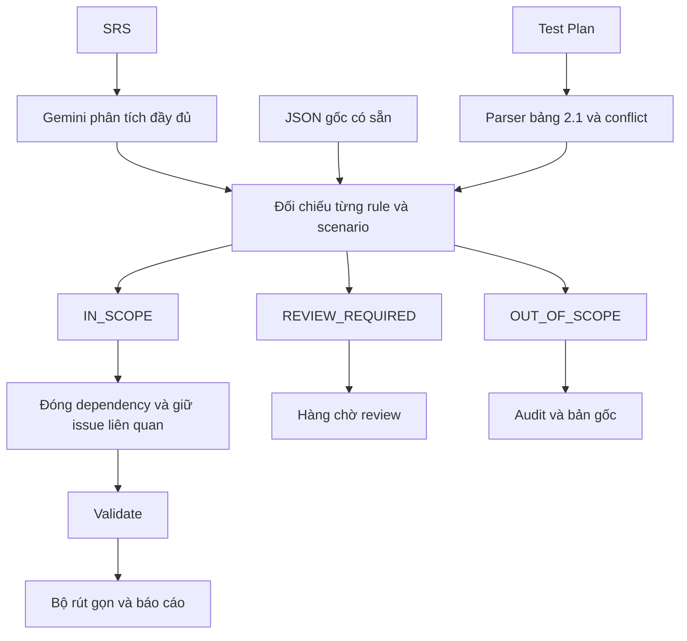

# Requirement Analyzer Gemini v3

Một Requirement Analyzer Agent Python: phân tích SRS bằng Gemini, sau đó **đối chiếu rule và scenario với Test Plan để tạo bộ rút gọn theo phạm vi**. Phát triển từ source v2 đã xuất, không tạo agent độc lập khác.

## 1 Thay đổi chính

- Nhận `--test-plan`; lấy **bảng 2.1 Hạng mục kiểm thử** làm baseline lọc theo mục tiêu thu hẹp phạm vi.
- Nhận `--analysis-json` để dùng kết quả SRS đã có, không gọi lại bước sinh rule/scenario.
- Xét cả module và outline. M03 chỉ xem danh sách Flash Sale không tự duyệt scenario mua/thêm giỏ.
- Ba nhóm quyết định: `IN_SCOPE`, `OUT_OF_SCOPE`, `REVIEW_REQUIRED`.
- Rule/scenario được giữ nguyên statement, ID, Given/When/Then và expected_status từ SRS.
- Lưu đủ kết quả gốc, mọi quyết định, lý do, quote nguồn Test Plan và hàng chờ review.
- Scenario được giữ cần rule nào thì giữ rule đó làm dependency; ghi rõ không phải tự mở scope.
- PR thành checklist quản lý dự án `NOT_ASSESSED`, không sinh giả test chức năng.
- TC ước tính không phải quota; scenario không tương đương 1:1 test case.

## 2 Scope của Test Plan đính kèm

| Loại | Mã | Outline | TC ước tính |
|---|---|---|---:|
| FR | FR-M02 | Tìm kiếm và lọc truyện | 10 |
| FR | FR-M03 | Xem danh sách Flash Sale | 6 |
| FR | FR-M04 | Thêm/xóa/sửa số lượng giỏ, tính tổng tiền | 10 |
| FR | FR-M09 | Chọn voucher, điều kiện áp dụng | 14 |
| FR | FR-M13 | Gợi ý truyện liên quan/yêu thích | 11 |
| FR | FR-M19 | Dashboard doanh thu, đơn hàng, bán chạy | 8 |
| NFR | NFR-03 | Hash mật khẩu Bcrypt | 5 |
| NFR | NFR-04 | Bảo mật web, SQL Injection | 8 |
| NFR | NFR-05 | Responsive Chrome/Edge | 6 |
| PR | PR-01 | Tiến độ bàn giao/phê duyệt Test Plan | 2 |
| PR | PR-02 | Ghi nhận và phân loại bug | 2 |

11 hạng mục, tổng **82 TC ước tính**. Các mục khác còn nói M01–M20 không được dùng để tự mở scope. V3 cảnh báo: phạm vi rộng mâu thuẫn bảng 2.1, Excel/Jira chưa thống nhất, Chrome/Edge so với Firefox/Safari, trang phê duyệt còn placeholder. Không sửa tài liệu gốc hoặc coi kế hoạch đã được duyệt.

## 3 Cài đặt

Python 3.10+; đã kiểm tra trên Python 3.12.

Windows PowerShell, từ thư mục dự án:

```powershell
python -m venv .venv
.\.venv\Scripts\Activate.ps1
python -m pip install -r requirements.txt
Copy-Item .env.example .env
```

Nếu PowerShell chặn kích hoạt, gọi `.\.venv\Scripts\python.exe` thay `python`, không cần đổi chính sách máy.

Linux/macOS:

```bash
python3 -m venv .venv
source .venv/bin/activate
python -m pip install -r requirements.txt
cp .env.example .env
```

Điền key riêng khi dùng Gemini:

```dotenv
GEMINI_API_KEY=your_gemini_api_key_here
GEMINI_MODEL=gemini-flash-latest
```

Chọn model tài khoản có quyền sử dụng. Không commit `.env` hoặc đưa key vào SRS/Test Plan.

## 4 Chạy ngay không cần key

Dùng kết quả SRS cũ và Test Plan bạn gửi:

```bash
python main.py --analysis-json examples/analysis_comic_original.json --test-plan examples/test_plan_comic.docx --scope-mode conservative --output outputs/comic_scope_v3
```

Mở `outputs/comic_scope_v3/scope_report.html` để xem trước/sau, mapping và lý do.

Chế độ conservative dùng metadata module và bộ khái niệm tiếng Việt có giới hạn; không phải đối chiếu ngữ nghĩa hoàn chỉnh. Nội dung không chắc được lưu `review_queue`. Với outline khác chuyên ngành/ngôn ngữ nên dùng Gemini hoặc reviewer.

## 5 Đối chiếu ngữ nghĩa bằng Gemini

Sau khi điền key:

```bash
python main.py --analysis-json examples/analysis_comic_original.json --test-plan examples/test_plan_comic.docx --scope-mode gemini --output outputs/comic_scope_gemini
```

Gemini chỉ trả quyết định scope theo schema, không được viết lại expected. Mỗi record phải có đúng một decision. IN_SCOPE cần hạng mục FR/NFR và quote nguyên văn của hàng scope. ID/quote giả bị từ chối; lỗi key/quota/schema không tự chuyển sang offline.

API chạy batch 8 record: 138 rule/scenario tương ứng 18 batch scope trước retry. Chi phí tùy model và nội dung. Adapter được kiểm tra bằng mock, chưa gọi Gemini thật trong lần bàn giao vì chưa có key. Bộ kết quả đi kèm là **conservative**, không phải kết quả API mới.

## 6 Chạy mới từ SRS tới bộ rút gọn

```bash
python main.py --input examples/SRS_Website_ban_truyen_tranh_online_UC.docx --document-id SRS-COMIC --version 1.0 --test-plan examples/test_plan_comic.docx --scope-mode gemini --output outputs/full_run_v3
```

SRS được phân tích đầy đủ rồi mới lọc, để giữ bằng chứng cho phần ngoài phạm vi. `--resume` chỉ áp dụng checkpoint SRS; scope hiện chạy lại. `--skip-cross` bỏ review chéo SRS và có cảnh báo.

Chỉ kiểm tra parser, không gọi Gemini:

```bash
python main.py --input examples/SRS_Website_ban_truyen_tranh_online_UC.docx --test-plan examples/test_plan_comic.docx --parse-only --output outputs/parsed
```

Demo coupon v2 vẫn chạy (fixture):

```bash
python main.py --demo --output outputs/coupon_demo
```

## 7 Đầu ra

| File | Ý nghĩa |
|---|---|
| analysis_full.json | Payload SRS gốc trước lọc |
| analysis.json | Payload v3, bộ rút gọn và audit đầy đủ |
| test_plan_scope.json | Scope 2.1, block nguồn TP, quote và conflict |
| scope_comparison.json | Mọi decision, dependency, issue audit, coverage và review queue |
| scope_report.html | Báo cáo chính để review đối chiếu |
| report.html | Danh sách rút gọn theo format v2 |
| scope_decisions.csv | Mọi quyết định, mở được trong Excel |
| coverage_matrix.csv | Mapping plan item → rule/scenario |

Không lọc lặp `analysis.json` đã scope. Hãy dùng `analysis_full.json` hoặc kết quả gốc. Chọn output khác đường dẫn input để không ghi đè.

Các status:

- IN_SCOPE: mục tiêu được outline hỗ trợ theo matcher; vẫn cần reviewer kiểm tra.
- OUT_OF_SCOPE: không thuộc baseline, nhưng vẫn có trong bản gốc/audit.
- REVIEW_REQUIRED: chưa đủ căn cứ hoặc chỉ khớp một phần; không được xem là đã loại vĩnh viễn.
- dependency_rule_ids: giữ để scenario không tham chiếu rule bị mất; không mở toàn module.
- MAPPED_NEEDS_REVIEW: có mapping, không chứng minh đủ coverage.
- GAP_NEEDS_DESIGN: chưa có scenario được chọn; cần thiết kế bổ sung có căn cứ.
- PROCESS_CHECKLIST: PR quản lý dự án, chưa đánh giá hoàn thành.

Issue liên quan scenario hoặc block nguồn của rule được giữ sẽ tiếp tục nằm trong bộ rút gọn. `blocks_scenarios` của issue rút gọn chỉ trỏ scenario còn lại; liên kết trước/sau nằm trong `issue_audit`, bản gốc vẫn đầy đủ.

## 8 Kết quả đã chạy

Trên JSON bạn gửi (72 rule, 66 scenario, 31 issue), chế độ conservative:

- **15 rule, 13 scenario, 4 issue** sau lọc.
- 15 rule gồm **14 IN_SCOPE và 1 dependency** (`C004-BR1`).
- 27 decision IN_SCOPE = 14 rule + 13 scenario.
- **14 record chờ review: 8 rule, 6 scenario**.
- 97 decision OUT_OF_SCOPE; không xóa khỏi audit hoặc bản gốc.
- NFR-04/NFR-05 chưa có scenario được đối chiếu khớp từ kết quả cũ; không bịa để đủ số TC.
- 2 PR là checklist NOT_ASSESSED.

Trong ma trận, rule trực tiếp và dependency được ghi riêng. FR-M03 có thể có scenario được giữ nhờ dependency dù 0 rule được phân loại trực tiếp IN_SCOPE. Số lượng này là minh họa lọc bảo thủ, không phải bộ 82 test case hay kết quả PASS. Khi dùng Gemini có thể thay đổi và cần review.

## 9 Quy trình review

1. Xác nhận mục 2.1 đúng là baseline mong muốn; xử lý các conflict kế hoạch.
2. Đọc decision cùng outline, quote Test Plan và source_refs SRS.
3. Review 8 rule/6 scenario chưa chắc, không bỏ qua hàng chờ.
4. NFR khác mã phải so nội dung. Bcrypt trong plan không chứng minh SRS đã yêu cầu Bcrypt nếu chỉ ghi hash: cần xác nhận, không thay expected cũ.
5. Nếu phạm vi thay đổi, sửa **bản sao** Test Plan rồi chạy lại; lưu quyết định reviewer riêng.
6. Bổ sung GAP qua thiết kế test case có căn cứ. V3 lọc, không tự sinh đủ 82 TC.

## 10 Luồng và source



- `analyzer/testplan.py`: schema scope, parser 2.1 và phát hiện conflict phổ biến.
- `analyzer/scope.py`: conservative/Gemini matcher, validate evidence, lọc và dependency.
- `analyzer/scope_report.py`: báo cáo đối chiếu HTML và CSV.
- `main.py`: tích hợp SRS mới/JSON cũ và Test Plan.

`agent_version=3.0`, `scope_prompt_version=3.0`. Prompt SRS kế thừa source v2 (`prompt_version=2.0` khi chạy mới). JSON cũ giữ prompt_version 2.1. `scope_run` ghi provider/model/thời điểm riêng để không nhầm dữ liệu cũ được sinh lại.

## 11 Kiểm thử và giới hạn

```bash
python -m pytest -q
```

Test gồm baseline thật, không sửa input, không cắt theo quota, outline Flash Sale hẹp, giỏ hàng, NFR khác mã, dependency, UNKNOWN + issue, PR checklist, ID/quote giả, HTML escaping, Gemini mock và tương thích v2.

Parser scope hỗ trợ bảng 2.1 như tài liệu đi kèm; TXT/MD mỗi hàng ngăn cột bằng `|`. Ô merge/nhiều dòng phức tạp, heading khác hoặc bảng PDF cần chuẩn hóa/điều chỉnh parser. Không tìm thấy bảng thì dừng, không dùng lịch sử thay đổi làm scope. Cảnh báo conflict hiện nhận diện một số dạng phổ biến, không bảo đảm phát hiện toàn bộ mâu thuẫn.

Gemini và conservative đều có thể phân loại sai ngữ nghĩa. Quote đúng không thay thế review. V3 không thực thi test, không tự tạo bug Jira, không tự duyệt Test Plan, không tự sửa thiếu sót trong kết quả SRS cũ.

Tài liệu SDK chính thức:
- https://ai.google.dev/gemini-api/docs/structured-output
- https://github.com/googleapis/python-genai
